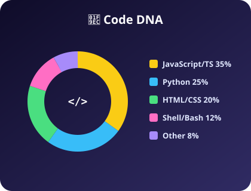

<div align="center">


<br/>

<a href="https://github.com/devlopergit04"></a>


</div>


<table>
<tr>
<td width="55%" valign="middle">

## 👨‍💻 About Me

Hey there! I'm **Developer04**, a programmer who loves turning ideas into fast, beautiful and reliable software.

- 🔭 Currently building **full‑stack web apps** and **smart Telegram bots**
- 🌱 Always learning: **cloud, AI integrations & system design**
- 🤖 Love automating boring stuff with **Python & Node.js**
- 👯 Looking to collaborate on **open‑source projects**
- 💬 Ask me about **JavaScript, TypeScript, React, Node.js & Python**
- 🐧 Daily driver: **Linux + VS Code + a terminal full of aliases**
- ⚡ Fun fact: I debug better after midnight 🌙

</td>
<td width="45%" align="center">


</td>
</tr>
</table>

<div align="center">



</div>


<div align="center">

## 🎭 Meet My Coding Crew

<table>
<tr>
<td align="center" width="33%"><br/><b>🧑‍🚀 Space Coder</b><br/><sub>pushes code to orbit</sub></td>
<td align="center" width="33%"><br/><b>🐱 Debug Cat</b><br/><sub>finds every bug</sub></td>
<td align="center" width="33%"><br/><b>🚀 Deploy Rocket</b><br/><sub>ships to production</sub></td>
</tr>
</table>


## ⚡ Skills & Superpowers


## 🛠️ Tech Stack

### 🎨 Frontend


### ⚙️ Backend


### 🗄️ Databases


### ☁️ DevOps & Cloud


### 🧰 Tools & Others


<br/>


## 🛤️ Journey


## 📊 Stats


<br/><br/>

<table><tr>
<td width="60%"></td>
<td width="40%"></td>
</tr></table>


<br/>


## 🚀 What I Do

| 🎨 Frontend | ⚙️ Backend | ☁️ DevOps | 🤖 Automation & AI |
|:---:|:---:|:---:|:---:|
| Responsive, animated UIs | REST & GraphQL APIs | CI/CD pipelines | Telegram & Discord bots |
| React · Next.js · Vue · Tailwind | Node.js · Express · Python · FastAPI | Docker · Netlify · GitHub Actions | LLM APIs & AI agents |
| Accessibility & performance | Databases & auth | Linux servers & VPS | Web scraping & downloaders |
| SVG animations & design | Real‑time with WebSockets | Monitoring & automation | Scripts that save hours |


## 🌟 Featured Projects

| Project | Description |
|:---|:---|
| 🤖 [downloader-bot](https://github.com/devlopergit04/downloader-bot) | Python Telegram downloader bot 🐍 |
| 🌍 [world-war-game-bot](https://github.com/devlopergit04/world-war-game-bot) | World war strategy game bot 🐍 |
| 👻 [GhostDesk](https://github.com/devlopergit04/GhostDesk) | Desktop experiment 👻 |
| 🖥️ [ubuntu-novnc-vps](https://github.com/devlopergit04/ubuntu-novnc-vps) | Throwaway Ubuntu XFCE desktop on GitHub Actions, served in the browser via noVNC + Cloudflare Tunnel |
| 🛰️ [Obsidian-Telemetry](https://github.com/devlopergit04/Obsidian-Telemetry) | TypeScript telemetry project |
| 🌱 [tiny-robot-garden](https://github.com/devlopergit04/tiny-robot-garden) | A tiny robot who tends a garden under the stars, with animated SVG scenes |
| 🎙️ [voicestudio.sh](https://github.com/devlopergit04/voicestudio.sh) | Voice studio shell script |


## 🔭 Currently Learning


## 💡 Dev Philosophy

```js
const developer04 = {
  code: "clean & readable",
  ship: () => "fast, but tested",
  learn: Infinity,
  coffee: "☕".repeat(Number.MAX_SAFE_INTEGER),
  motto: "Make it work, make it right, make it fast."
};
```


## 🤝 Connect With Me

<a href="https://github.com/devlopergit04"></a>

<br/><br/>


</div>
